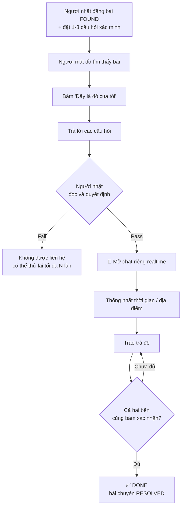
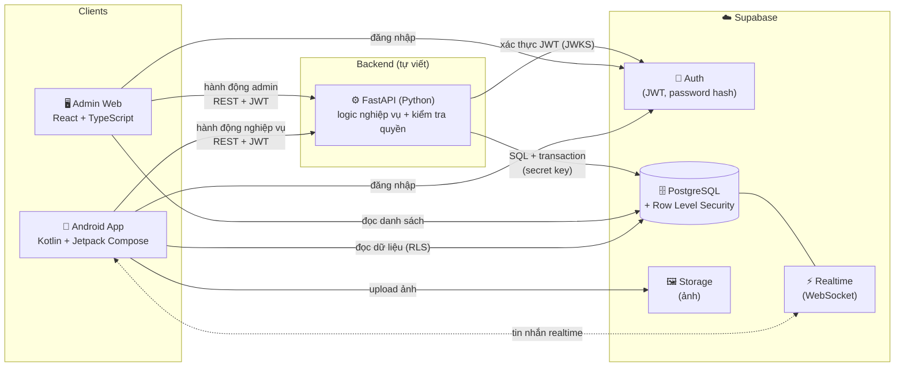
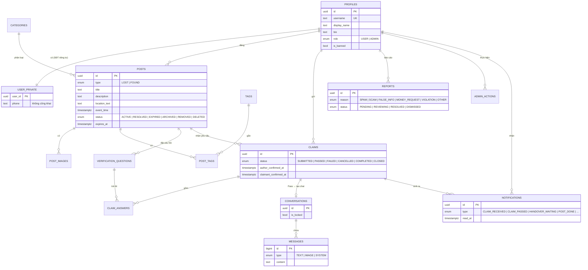
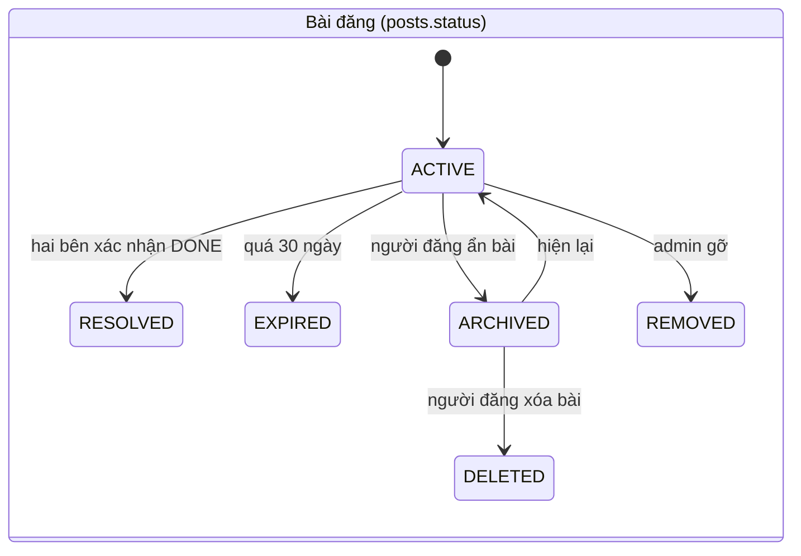
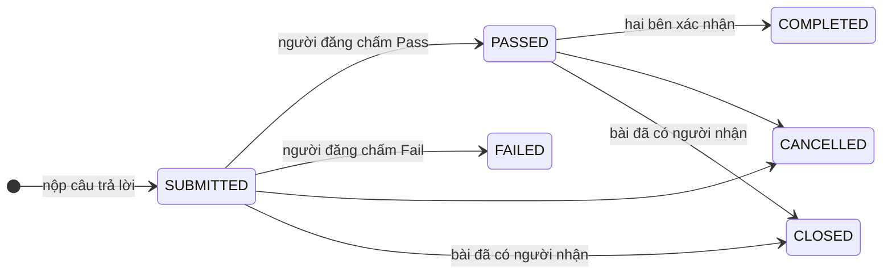

# 🔎 Lost & Found

> Ứng dụng di động giúp **người mất đồ** và **người nhặt được đồ** tìm thấy nhau, đồng thời hạn chế giả mạo và lợi dụng thông tin bài đăng.

-3DDC84)
-009688)
-3ECF8E)


---

## 1. Vấn đề và hướng giải quyết

Các nhóm Facebook "nhặt được của rơi" có hai vấn đề lớn:

| Vấn đề | Hậu quả |
|---|---|
| Ai cũng bình luận được dưới bài nhặt đồ | Người **không phải chủ đồ** có thể nhận bừa, người nhặt bị làm phiền hoặc bị lừa |
| Thông tin liên hệ công khai | Bị spam, bị lợi dụng, bị đòi tiền "chuộc" |

**Lost & Found không dùng comment công khai.** Thay vào đó, luồng chính của hệ thống là:

```
Find  →  Verify  →  Contact  →  Return  →  Confirm  →  Done
Tìm      Xác minh   Chat riêng   Trao trả   2 bên xác nhận   Hoàn tất
```

### Luồng xác minh quyền sở hữu (điểm đặc trưng)



> Hệ thống **không tự kết luận** ai là chủ sở hữu. Quyết định Pass/Fail thuộc về người nhặt đồ.
> Bài không được xử lý sau **30 ngày** sẽ tự chuyển `EXPIRED`.

---

## 2. Tính năng (phạm vi MVP)

| Nhóm | Chức năng |
|---|---|
| 👤 Tài khoản | Đăng ký / đăng nhập bằng email + password, kiểm tra điều kiện tối thiểu, không trùng tài khoản, quên / đổi mật khẩu bằng mã gửi qua email, số điện thoại lưu nhưng **không công khai**, phân quyền User / Admin, password luôn được hash |
| 📰 Bảng tin | Chuyển đổi **Lost** (đồ mình mất) / **Found** (đồ mình nhặt), bài đăng gồm ảnh, mô tả, loại tài sản, tag, địa điểm, thời gian, người đăng; tìm kiếm + bộ lọc (loại bài, danh mục, thời gian đăng), sắp xếp **Mới nhất / Gần nhất**, khối **Cần xử lý** trên trang chủ |
| 🛡️ Xác minh | Câu hỏi do người nhặt đặt, người nhận chủ phải trả lời, người nhặt chấm Pass/Fail |
| 💬 Nhắn tin | Chat riêng 1-1 realtime, lưu lịch sử, không có comment công khai |
| ✅ Hoàn tất | Hai bên cùng xác nhận → DONE; bài quá hạn → Expired/Archived; người dùng có thể ẩn / hiện lại / xóa bài của mình |
| 🔔 Thông báo | Yêu cầu xác minh mới, được duyệt nhắn tin, chờ xác nhận trao trả, bài DONE, kết quả xử lý báo cáo |
| 🚩 Report & Admin | Báo cáo spam, scam, thông tin sai, đòi tiền bất thường; admin xử lý report, gỡ bài, khóa tài khoản |

**Chưa làm trong MVP:** AI matching, recommendation, OTP, comment, map realtime, tính năng social phụ.

---

## 3. Kiến trúc tổng quan



### Quy tắc phân chia (dễ nhớ)

> **Đọc → đi thẳng Supabase (được RLS bảo vệ).  Ghi thay đổi trạng thái nghiệp vụ → đi qua FastAPI.**

| Việc cần làm | Đi đường nào | Vì sao |
|---|---|---|
| Xem bảng tin, tìm kiếm, xem chi tiết | App → Supabase (PostgREST / RPC `search_posts`) | Nhanh, ít code, RLS tự chặn dữ liệu không được xem |
| Gửi / nhận tin nhắn | App → Supabase Realtime | Realtime, độ trễ thấp |
| Upload ảnh | App → Supabase Storage | Không tốn băng thông backend |
| Đăng ký tài khoản | App → **FastAPI** | Kiểm tra email/password ở server, tự tạo hồ sơ và handle công khai |
| Đăng nhập, quên / đổi mật khẩu | App → Supabase Auth | Dùng sẵn, không cần viết lại |
| Cập nhật số điện thoại | App → **FastAPI** | SĐT nằm ở bảng riêng tư, không cho client ghi trực tiếp |
| Sắp xếp theo khoảng cách, số liệu "Cần xử lý" | App → Supabase (RPC) | Hàm SQL `search_posts`, `my_todo_counts` |
| Tạo bài (ảnh + tag + câu hỏi) | App → **FastAPI** | Cần transaction nhiều bảng, kiểm tra dữ liệu |
| Lấy câu hỏi, nộp câu trả lời, Pass/Fail | App → **FastAPI** | Giới hạn số lần thử, chống dò đáp án |
| Xác nhận DONE | App → **FastAPI** | Đảm bảo đúng quy tắc hai bên xác nhận |
| Report, xử lý report, gỡ bài, khóa tài khoản | App/Web → **FastAPI** | Phải kiểm tra quyền Admin và ghi nhật ký |

---

## 4. Công nghệ sử dụng

### 📱 Mobile (Android)

| Mục đích | Công nghệ |
|---|---|
| Ngôn ngữ / UI | Kotlin, Jetpack Compose, Material 3 |
| Kiến trúc | MVVM (UI → ViewModel → Repository), Kotlin Coroutines + Flow |
| Điều hướng | Navigation Compose |
| Dependency Injection | Hilt (hoặc Koin) |
| Kết nối Supabase | `supabase-kt` (Auth, Postgrest, Storage, Realtime) |
| Gọi FastAPI | Retrofit + OkHttp + kotlinx.serialization |
| Hiển thị ảnh | Coil |
| Phân trang bảng tin | Paging 3 |
| Chọn ảnh | Android Photo Picker |
| Vị trí hiện tại ("Gần nhất") | Fused Location Provider |
| Lưu phiên đăng nhập | DataStore |

### ⚙️ Backend

| Mục đích | Công nghệ |
|---|---|
| Framework | FastAPI + Uvicorn, Pydantic v2 |
| Truy cập DB | `psycopg` 3 + `psycopg_pool`, viết SQL trực tiếp, kết nối qua **Session pooler** của Supabase |
| Gọi Supabase từ backend | `httpx` (Auth Admin API để tạo tài khoản, PostgREST để ghi hồ sơ) |
| Xác thực | Kiểm tra JWT của Supabase bằng JWKS (PyJWT) |
| Giới hạn tốc độ | slowapi |
| Gửi email (quên mật khẩu) | SMTP riêng (Resend hoặc Gmail SMTP), vì dịch vụ email mặc định của Supabase giới hạn rất thấp |
| Triển khai | Render (Python 3, không dùng Docker), tự triển khai lại mỗi khi gộp code vào nhánh `develop` |

### 🗄️ Database & dịch vụ

| Mục đích | Công nghệ |
|---|---|
| CSDL | Supabase PostgreSQL |
| Đăng nhập | Supabase Auth (password hash bằng bcrypt) |
| Bảo mật dữ liệu | Row Level Security (RLS) |
| Chat realtime | Supabase Realtime |
| Lưu ảnh | Supabase Storage |
| Tìm kiếm tiếng Việt không dấu | `pg_trgm` + `unaccent` |
| Tự hết hạn bài đăng | `pg_cron` |
| Migration | Supabase CLI |

### 🖥️ Admin Web

| Mục đích | Công nghệ |
|---|---|
| Framework | React + Vite + TypeScript |
| Giao diện | Tailwind CSS + shadcn/ui |
| Gọi dữ liệu | TanStack Query + TanStack Table |
| Đăng nhập | `supabase-js` |
| Triển khai | Vercel / Netlify / Cloudflare Pages |

---

## 5. Thiết kế cơ sở dữ liệu

Schema gồm **16 bảng**. Chạy `supabase/schema.sql` một lần trong SQL Editor của Supabase (nếu đã chạy dở, chạy `supabase/reset.sql` trước); toàn bộ (bảng, ràng buộc, trigger, hàm tìm kiếm, RLS, seed) nằm trong [`supabase/schema.sql`](supabase/schema.sql).



### Trạng thái bài đăng và yêu cầu xác minh





---

## 6. Bảo mật: những điểm chính

- **Password** được Supabase Auth hash (bcrypt); ứng dụng không bao giờ lưu hay ghi log password gốc.
- **Email và số điện thoại** không công khai: email nằm trong Supabase Auth, SĐT ở bảng riêng `user_private`, RLS chỉ cho chính chủ và admin đọc. Người khác chỉ thấy tên hiển thị và handle.
- **Đăng ký công khai bị tắt** ở Supabase; tài khoản chỉ được tạo qua FastAPI để kiểm tra điều kiện email/password.
- **Câu hỏi xác minh** chỉ trả về qua FastAPI, có giới hạn số lần thử để chống dò đáp án.
- **Tin nhắn** chỉ hai người trong cuộc đọc được. Admin chỉ xem chat bị report, qua FastAPI, và hành động này **được ghi log** (`admin_actions`).
- **Khóa bí mật** (`secret key`) chỉ nằm ở server FastAPI, không bao giờ đưa vào app hay web.
- **Thông báo** chỉ do hệ thống tạo (trigger trong DB), client không tự tạo hay gọi hàm tạo thông báo được.
- **Quy tắc nghiệp vụ quan trọng** (không tự claim bài của mình, DONE khi đủ hai bên, tự tạo chat khi Pass) được bảo vệ bằng **trigger trong database**, không phụ thuộc vào việc code client có đúng hay không.

---

## 7. Giao diện (thiết kế Figma)

Thiết kế nằm trong file Figma của nhóm (trang *01 - UI Design*, *02 - Components*).

| Nhóm màn hình | Nội dung |
|---|---|
| Khởi động & tài khoản | Splash, Đăng nhập, Đăng ký, Quên mật khẩu → Nhập mã → Đặt lại mật khẩu |
| Trang chủ | Lời chào, chuông thông báo, khối **Cần xử lý** (3 bộ đếm), tìm kiếm, sắp xếp Mới nhất / Gần nhất, tab Tất cả / Lost / Found, thẻ bài đăng |
| Tìm kiếm | Từ khóa, loại bài, danh mục, thời gian đăng, danh sách kết quả, trạng thái không có kết quả |
| Đăng bài | Lost / Found, tối đa 5 ảnh, tiêu đề, danh mục, tag, địa điểm, thời gian, mô tả, câu hỏi xác minh (bài Found) |
| Xác minh | Người nhận trả lời câu hỏi; người đăng duyệt danh sách yêu cầu → Từ chối / Cho phép nhắn tin |
| Nhắn tin & trao trả | Danh sách hội thoại, màn hình chat, bước **Xác nhận trao trả** với thanh tiến trình Xác minh → Chat → Trao trả → Hoàn tất |
| Bài của tôi | Đang đăng, Đã DONE, Đã ẩn (hiện lại, xóa, xem lý do bị gỡ) |
| Cá nhân | Hồ sơ, chỉnh sửa hồ sơ, đổi mật khẩu, báo cáo đã gửi, đăng xuất |
| Thông báo | Mục Mới / Trước đó, nút Đọc hết |

---

## 8. Cấu trúc repository

```
lost-and-found/
├── mobile/          # Android app (Kotlin, Jetpack Compose)
├── backend/         # FastAPI (xem backend/README.md)
│   ├── .env.example     # bản mẫu biến môi trường (file .env thật KHÔNG commit)
│   ├── requirements.txt
│   └── app/
│       ├── main.py          # tạo app, gắn các router
│       ├── db.py            # nhóm kết nối database
│       ├── core/            # config, security (kiểm tra JWT), deps (người dùng đang hoạt động)
│       ├── routers/         # nhận request: auth, me, (posts, claims, reports, admin)
│       ├── schemas/         # hình dạng dữ liệu và luật kiểm tra (Pydantic)
│       └── services/        # logic nghiệp vụ
├── admin-web/       # React + Vite + TypeScript
├── supabase/
│   ├── schema.sql       # toàn bộ database (bảng, trigger, RLS, hàm, seed)
│   └── reset.sql        # chỉ dùng khi phát triển: xóa sạch để chạy lại schema.sql
├── docs/            # api.md (hợp đồng API), decisions.md, kế hoạch 30 ngày (.docx), báo cáo
└── README.md
```

---

## 9. Lộ trình 30 ngày

Kế hoạch chi tiết từng ngày, phân công 3 người và hướng dẫn thực hiện nằm trong file **`docs/Lost-and-Found-Ke-hoach-30-ngay.docx`**.

| Mốc | Thời gian | Kết quả |
|---|---|---|
| **M1** Nền móng và đăng nhập | Ngày 1–7 | Supabase + schema, FastAPI đã triển khai, đăng ký / đăng nhập, khung giao diện, API được chốt |
| **M2** Đăng bài, bảng tin, xác minh | Ngày 8–14 | Đăng bài có ảnh, bảng tin, tìm kiếm, lọc, Gần nhất, trả lời và duyệt xác minh |
| **M3** Chat, DONE, báo cáo | Ngày 15–21 | Chat realtime, hai bên xác nhận ra DONE, thông báo, báo cáo, đóng băng tính năng |
| **M4** Admin web, hoàn thiện, phát hành | Ngày 22–28 | Admin web, APK cuối, báo cáo và slide, tập demo |
| Dự phòng | Ngày 29–30 | Sửa lỗi cuối và nộp bài |

Mức ưu tiên:

- **Bắt buộc:** đăng ký / đăng nhập, đăng bài, bảng tin và tìm kiếm, xác minh, chat, DONE, báo cáo và admin tối thiểu.
- **Nên có:** thông báo, Bài của tôi, khối Cần xử lý, sắp xếp Gần nhất, chỉnh sửa hồ sơ.
- **Nếu còn thời gian:** quên / đổi mật khẩu bằng mã email, ảnh đại diện, gửi ảnh trong chat, dashboard admin.

### Tình trạng hiện tại (cập nhật 23/10/2026)

Backend đang chạy tại **https://lost-found-api-ph8v.onrender.com** (trang thử API: `/docs`). Gói miễn phí tự tắt sau 15 phút không có truy cập nên lần gọi đầu có thể mất 30–50 giây.

| Việc | Trạng thái |
|---|---|
| Supabase: schema, Auth, Storage, Realtime | ✅ |
| Backend: `/health`, `/me` (kiểm tra token JWT) | ✅ |
| Backend: `POST /auth/register` | ✅ |
| Triển khai backend lên Render | ✅ |
| Tài liệu API ([`docs/api.md`](docs/api.md)) | ✅ |
| Backend: `PUT /me/phone` | 🚧 |
| Backend: `POST /posts` và các endpoint còn lại | 🚧 xem `docs/api.md` |
| Android: khung ứng dụng, đăng nhập | 🚧 |
| Admin web | 🚧 |

### Tiến độ

- [ ] **M1** Nền móng và đăng nhập (đang làm: phía backend đã xong phần đăng ký, đăng nhập, triển khai)
- [ ] **M2** Đăng bài, bảng tin, xác minh
- [ ] **M3** Chat, DONE, báo cáo
- [ ] **M4** Admin web, hoàn thiện, phát hành

---

## 10. Nhóm thực hiện

| Thành viên | Vai trò chính |
|---|---|
| Phạm Gia Khiêm | _(điền)_ |
| _(thành viên 2)_ | _(điền)_ |
| _(thành viên 3)_ | _(điền)_ |

Đồ án môn Lập trình thiết bị di động, Trường Đại học Giao thông Vận tải TP.HCM (UTH).
